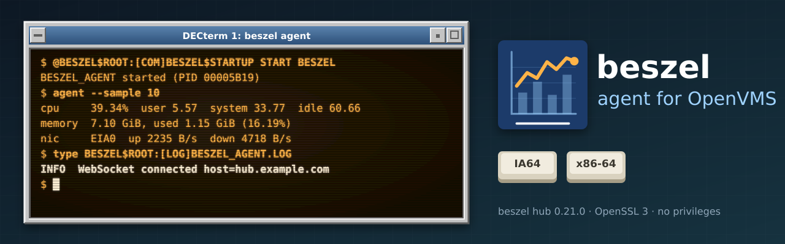
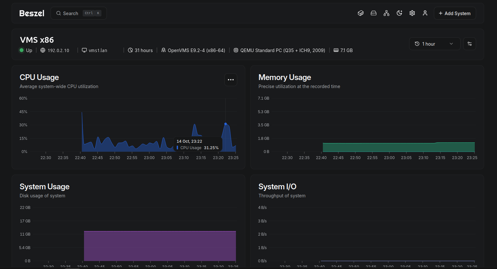
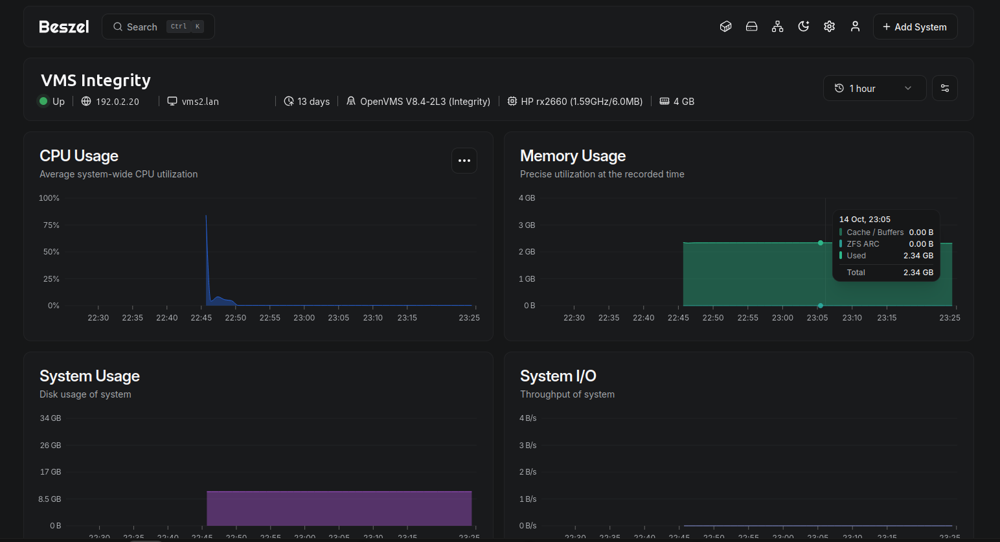

<p align="center">
  
</p>

# Beszel agent for OpenVMS


[](LICENSE)

A native agent for [beszel](https://beszel.dev), the lightweight server monitor, so your
**OpenVMS** systems (x86-64 and Integrity/IA64) appear in your beszel hub next to everything
else. You get live charts, history and alerts for CPU, memory, swap, disks, network and load.
It works with an unmodified beszel hub, version **0.21.0**.

Beszel's own agent is written in Go, which doesn't run on OpenVMS. This one is written in C
for OpenVMS and speaks the same protocol, checked byte for byte against beszel's own code. It
belongs to the [vms-* family](https://openvms.issinoho.com) of open-source tools for OpenVMS.

- **Outbound only.** The agent connects to the hub (WebSocket, optionally TLS); nothing listens on
  your OpenVMS system.
- **The hub must prove who it is.** The agent answers only a hub that signs your token with the
  private key matching the public key you configure.
- **No privileges.** The agent runs as its own account, with NETMBX and TMPMBX only. It
  refuses to run as SYSTEM, or as any account with more.
- **Light:** a working set of a few megabytes. After the first connection (a few seconds of CPU
  for the TLS handshake on x86), it uses very little CPU between the hub's once-a-minute requests.

> **Status:** working, and in testing on both architectures; the first PCSI kit
> (v0.21.0-vms1) is being prepared. Until it is published, [install from
> source](#installing-from-source); it takes a few minutes.

## What you see in the hub

<p align="center">
  
  
</p>
<p align="center"><em>An x86-64 system and an Integrity rx2660 in a beszel 0.21.0 hub, reported by this
agent. Host names and addresses have been replaced.</em></p>

| Chart | On OpenVMS |
|---|---|
| CPU, with user/system/idle breakdown and per-CPU usage | from the per-CPU mode counters (the same ones `MONITOR MODES` uses); user = user + supervisor mode, system = kernel + executive + interrupt + MP synchronisation |
| Load average (1, 5, 15 minutes) | derived the way Linux computes it, from the processes running and waiting for a CPU |
| Memory | used = total − free list − modified list; the XFC cache counts as used (OpenVMS doesn't report its size to programs) |
| Swap | page files plus swap files |
| Disk usage | the system disk, plus any disks you list |
| Network | bytes sent and received per LAN device. OpenVMS's 32-bit counters stop at 4 GiB; after that, the agent reads that device through LANCP every 30 s. |
| Uptime, host name, CPU model, CPU count, memory size | from the system |
| Alerts | every alert beszel offers for these: CPU, memory, disk, bandwidth, load average, and "system down" |

The system's OS shows as "OpenVMS E9.2-4 (x86-64)" or "OpenVMS V8.4-2L3 (Integrity)", next to
beszel's Linux penguin: the hub knows only four operating systems, and choosing any other would
break its system page.

**Not available on OpenVMS:** temperatures, fans, GPUs, batteries, containers, systemd services,
SMART and ZFS. Their charts and tables simply don't appear. **Disk I/O** is drawn as a flat
line at zero: OpenVMS counts disk operations but not bytes, and the agent won't invent numbers.

## Requirements

- OpenVMS **x86-64** (tested on E9.2-4) or **Integrity** (tested on V8.4-2L3).
- VSI **TCP/IP Services** and VSI's **SSL3** kit (OpenSSL 3.0), both standard on current systems.
- A beszel **hub, version 0.21.0**, that the OpenVMS system can reach. A hub behind a reverse
  proxy works, with or without a path prefix (tested with Nginx Proxy Manager).

## 1. Add the system in your hub

In the hub, click **Add System**:

- **Name:** whatever you like, for example `VMS1`.
- **Host / IP:** the OpenVMS system's address. The hub only shows it, because the agent connects
  out to the hub, not the other way round.
- **Port:** leave the default.

The dialog shows a **public key** (`ssh-ed25519 AAAA…`) and a **token**. Copy both; you need them
in step 3. Ignore the Docker and binary install commands, which are for Linux. Click **Add
System**. It shows as pending until the agent connects.

To add many systems, a **universal token** (Settings, Tokens & Fingerprints) lets each agent add
its own system. Set `TOKEN` to the universal token and, optionally, `SYSTEM_NAME`.

## 2. Install the agent

### With the PCSI kit

*(The first kit, v0.21.0-vms1, is being prepared; this is how it will install.)* Download the
kit for your architecture from the [releases page](https://github.com/issinoho/vms-beszel/releases)
and check it against the release's `SHA256SUMS`. A kit copied through a non-VMS system loses
its record format, so restore that first:

```
$ SET FILE/ATTRIBUTE=(RFM:FIX,LRL:8192,MRS:8192,RAT:NONE) ISSINOHO-*-BESZEL_AGENT-*.PCSI
$ PRODUCT INSTALL BESZEL_AGENT /PRODUCER=ISSINOHO /SOURCE=dev:[dir]
```

### Installing from source

On the OpenVMS system, with VSI C and the SSL3 kit:

```
$ ! get the sources (git clone on another system, then copy the directory tree over)
$ SET DEFAULT dev:[vms-beszel]
$ @BUILD_VMS TEST                      ! builds [.BUILD]BESZEL_AGENT.EXE and runs the unit tests
```

Then lay out the agent's directory tree, on any disk (here `SYS$SYSDEVICE:[BESZEL]`):

```
$ CREATE/DIRECTORY SYS$SYSDEVICE:[BESZEL.BIN], [BESZEL.COM], [BESZEL.LOG]
$ CREATE/DIRECTORY/PROTECTION=(S:RWE,O:RWE,G,W) SYS$SYSDEVICE:[BESZEL.CONF], [BESZEL.DATA]
$ COPY [.BUILD]BESZEL_AGENT.EXE, BESZEL_LAUNCH.EXE SYS$SYSDEVICE:[BESZEL.BIN]
$ COPY [.VMS]BESZEL$CONTROL.COM, BESZEL$RUN.COM SYS$SYSDEVICE:[BESZEL.COM]
$ COPY [.VMS]AGENT.CONF_TEMPLATE SYS$SYSDEVICE:[BESZEL.CONF]
$ ! the public CA certificates, for an https hub: curl.se's extract of Mozilla's store
$ COPY cacert.pem SYS$SYSDEVICE:[BESZEL.CONF]CACERT.PEM
$ DEFINE/SYSTEM/EXECUTIVE/TRANSLATION=CONCEALED BESZEL$ROOT SYS$SYSDEVICE:[BESZEL.]
```

`CACERT.PEM` comes from <https://curl.se/ca/cacert.pem>. Fetch it on a system with a browser or
curl, and check it against curl.se's published SHA-256.

### The agent's account

The agent won't run as SYSTEM, or as any account with privileges beyond NETMBX and TMPMBX.
A process with a system UIC, or one authorized for privileges it could turn back on, could
do far more than report statistics. So it needs a small account of its own. The kit will
create it; with a from-source install, as SYSTEM:

```
$ SET DEFAULT SYS$SYSTEM
$ RUN AUTHORIZE
UAF> ADD BESZEL /UIC=[377,1] /PASSWORD=<a long random one> /OWNER="beszel agent" -
     /PRIVILEGES=(NETMBX,TMPMBX) /DEFPRIVILEGES=(NETMBX,TMPMBX) -
     /FLAGS=(NODISUSER,DISCTLY,LOCKPWD) /LGICMD="NL:" /PWDLIFETIME=NONE -
     /NOLOCAL /NODIALUP /NOREMOTE /NONETWORK /NOBATCH -
     /DEVICE=SYS$SYSDEVICE /DIRECTORY=[BESZEL]
UAF> EXIT
$ SET FILE/OWNER=BESZEL SYS$SYSDEVICE:[BESZEL]CONF.DIR,DATA.DIR,LOG.DIR
$ SET FILE/PROTECTION=(S:RWE,O:RWE,G:RE,W:RE) SYS$SYSDEVICE:[000000]BESZEL.DIR, -
     SYS$SYSDEVICE:[BESZEL]BIN.DIR,COM.DIR
$ SET FILE/PROTECTION=(S:RWED,O:RWED,G:RE,W:RE) SYS$SYSDEVICE:[BESZEL.BIN]*.*,[BESZEL.COM]*.*
$ DEFINE/SYSTEM/EXECUTIVE BESZEL$USER BESZEL
```

Choose a UIC group of its own, above `MAXSYSGROUP` (8 by default). The account can't log
in by any route: every login class is turned off. It still runs the agent, because START
creates the agent's process under the account's identity. **Don't** give it the DISUSER
flag: OpenVMS then refuses to create processes as it. Everything the account uses must be
reachable by it: `[BIN]` and `[COM]` world-readable, `[CONF]`, `[DATA]` and `[LOG]` its own.

## 3. Configure

```
$ COPY BESZEL$ROOT:[CONF]AGENT.CONF_TEMPLATE BESZEL$ROOT:[CONF]AGENT.CONF
$ SET FILE/OWNER=BESZEL/PROTECTION=(S:RWED,O:RWED,G,W) BESZEL$ROOT:[CONF]AGENT.CONF
$ EDIT BESZEL$ROOT:[CONF]AGENT.CONF
```

Three settings are required:

```
HUB_URL=https://beszel.example.com
KEY="ssh-ed25519 AAAA...the key from step 1..."
TOKEN=the-token-from-step-1
```

`HUB_URL` is the address you open the hub at in a browser, including any path. **Use `https://`**
whenever the network between the system and the hub isn't fully yours. Over plain `http://`, the
token travels in clear text, and someone on the path could use it to pose as your system.

Everything else
is optional and explained in the file:
- `EXTRA_FILESYSTEMS`: more disks to chart, for example `DKA100:__Data,DSA2:__Shadow`;
- `FILESYSTEM`: the main disk, `SYS$SYSDEVICE:` by default;
- `NICS`: which LAN devices to count;
- `CA_CERT_FILE`: your own CA, for a hub with a private certificate;
- `LOG_LEVEL`.

The names are beszel's own, as on <https://beszel.dev>. Any setting can also come from a
logical name `BESZEL$<NAME>`, which wins over the file.

The file holds the token, so keep it readable by its owner (BESZEL) only. The agent warns in its
log if it isn't. `EDIT` makes a new version each time: set the protection again afterwards, and
`PURGE` the old versions, which hold the token too.

**Check before you start it:** this prints what the agent would report, without contacting the
hub:

```
$ AGENT := $BESZEL$ROOT:[BIN]BESZEL_AGENT.EXE
$ AGENT --SAMPLE 10 DKA100:
```

## 4. Start it

```
$ @BESZEL$ROOT:[COM]BESZEL$CONTROL START
BESZEL_AGENT started (PID 0000a1b2)
```

Run it as SYSTEM (or another account with IMPERSONATE and DETACH): it starts the agent as
`BESZEL$USER`, or as the account you give as a second parameter (`START BESZEL`). It refuses
SYSTEM itself, or an account that doesn't exist. Within a minute the system shows as **up**
in the hub. To start it at every boot, add the two `DEFINE` lines above and the
`@...BESZEL$CONTROL START` line to `SYS$MANAGER:SYSTARTUP_VMS.COM`, after TCP/IP has
started. The kit will do the defining for you.

| Command (`@BESZEL$ROOT:[COM]BESZEL$CONTROL ...`) | Does |
|---|---|
| `START` | Starts the detached process `BESZEL_AGENT` |
| `STOP` | Asks the agent to stop. It says goodbye to the hub, which marks the system down at once. |
| `RESTART` | Stop, then start: needed after you change `AGENT.CONF` |
| `STATUS` | Whether it runs, and its CPU time and memory |

The log is `BESZEL$ROOT:[LOG]BESZEL_AGENT.LOG`. A new one is started at each START, and the last
five are kept. If the agent stops unexpectedly, it is started again after 15 s, then after
longer waits (up to 5 minutes) if it keeps failing. Every reason is logged.

## When it doesn't connect

The log says why. These are the messages you may see:

| Log message | What to do |
|---|---|
| `hub answered 401 Unauthorized (check TOKEN)` | The token doesn't match a system in the hub. Copy it again from the system's menu in the hub. |
| `invalid signature - check KEY value` | `KEY` isn't this hub's public key. Copy it again from "Add System". |
| `Connection closed code=1000 reason="fingerprint mismatch"` | The hub knows this system with another fingerprint (for example, after `[DATA]` was deleted). Reset the fingerprint in the hub (Settings, Tokens & Fingerprints). |
| `TLS: certificate not trusted: unable to get local issuer certificate` | The hub's certificate is from a CA the agent doesn't know. Point `CA_CERT_FILE` at that CA's PEM file. |
| `TLS: the hub's certificate is not for <name>` | `HUB_URL` uses a name or address the certificate doesn't list. Use the name on the certificate. |
| `lookup of <name> failed` | DNS: check that `TCPIP SHOW HOST <name>` works on the OpenVMS system. |
| `connect: connection refused` / `timed out` | The hub, or a firewall, isn't letting the system in. Check `HUB_URL` and the port. |
| `HUB_URL must start with http:// or https://` | Use the address you open in a browser, not `ws://` or `wss://`. |
| `refusing to run the agent as SYSTEM` / `authorized for privileges beyond NETMBX and TMPMBX` | Run it as its own account (see "The agent's account"). The agent won't run as SYSTEM or with privileges. |
| `HUB_URL is http://: the token crosses the network in clear text` | A warning, not an error. Use `https://` if anyone else could be on the path. |
| `line N: unknown setting "..."` | A typing mistake in `AGENT.CONF`. The agent refuses settings it doesn't know. |

The agent retries every 10 seconds, so you can fix the problem and simply wait. Settings,
though, are only read at start: run `RESTART` after changing the file.

## Differences from beszel's Linux agent

- **WebSocket only.** Beszel's other mode, where the hub logs in to the agent over SSH on port
  45876, isn't supported, so nothing listens on your system. Add the system with the token, as
  above.
- `HUB_URL` must be `http://` or `https://`. Beszel's agent quietly turns `wss://` into an
  unencrypted connection; this one refuses it instead.
- `NICS` names are LAN devices (`EWA0`, `EIA0`), matched without regard to case.
- Docker, GPU, sensor, SMART, systemd and package-update settings don't exist here.

## Building, testing, contributing

The code is portable C99 with a small OpenVMS layer, so most of it is built and tested on Linux
too:
- `make test` runs the unit tests;
- `make fuzz` fuzzes everything that parses network input;
- `make conformance` checks every message against beszel's own Go code at the pinned version;
- `tests/integration/itest.py` runs the agent against beszel's own hub.

`docs/` holds the plan, the protocol notes and every design decision.

## Artwork

`docs/images/banner.svg` and `docs/images/icon.svg` were made for this project in the style of
classic DECwindows and VT terminals, like those of its sibling ports. The chart mark is our own
drawing, not beszel's logo. The terminal shows real output from the x86 test node, with the
hub's address replaced.

## Licence

MIT; see [LICENSE](LICENSE). beszel is © its authors, under the MIT licence; this project
contains none of its code. The CA bundle you install is Mozilla's root store as published by the
curl project, under the MPL 2.0.

OpenVMS is a trademark of VMS Software, Inc. This project is not affiliated with VMS Software,
Inc. or with the beszel project.
